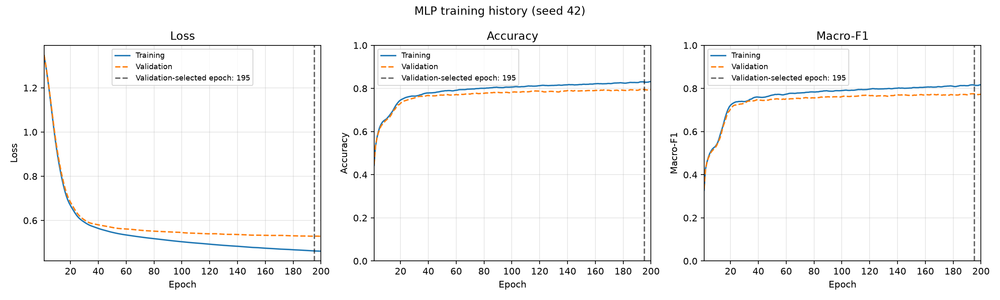
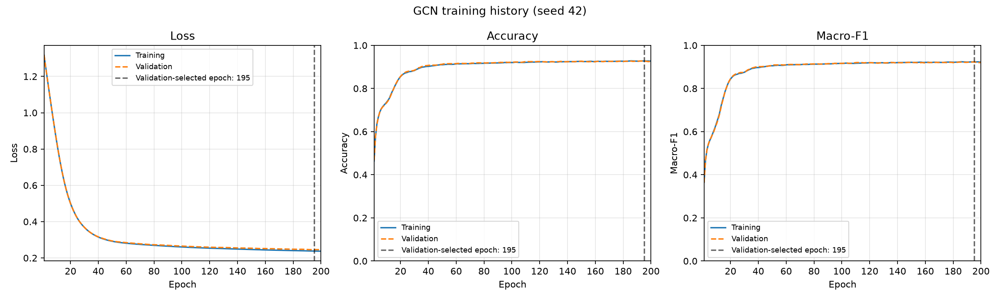
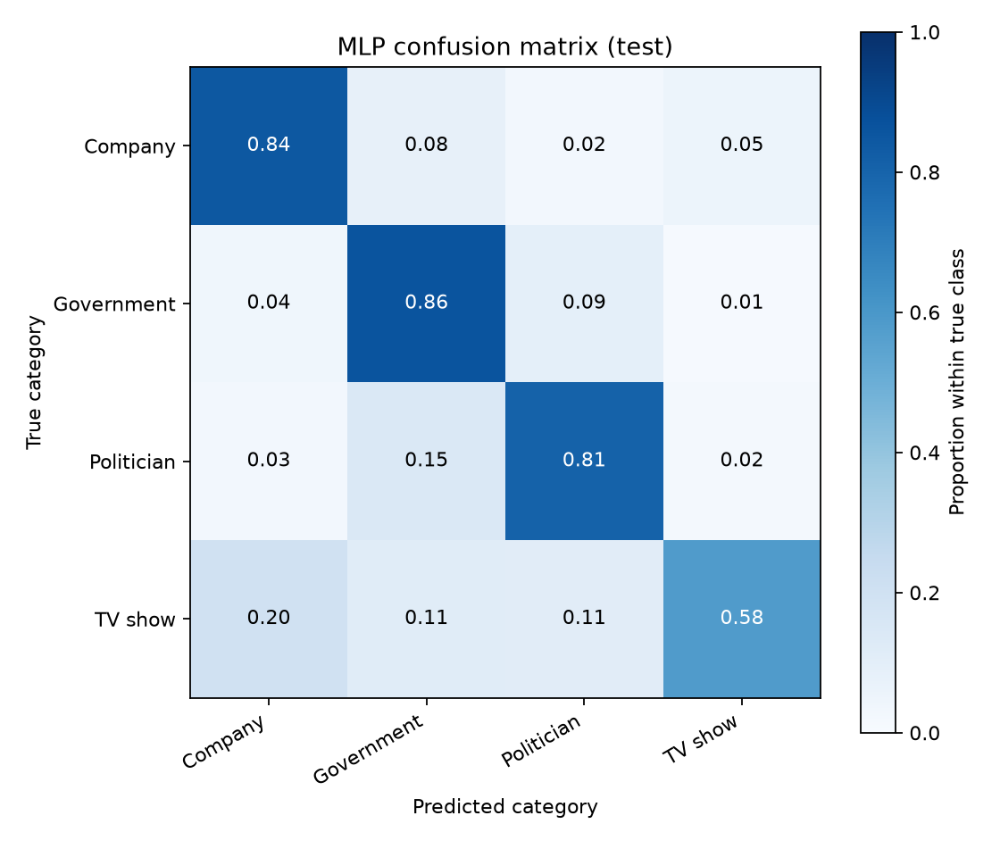
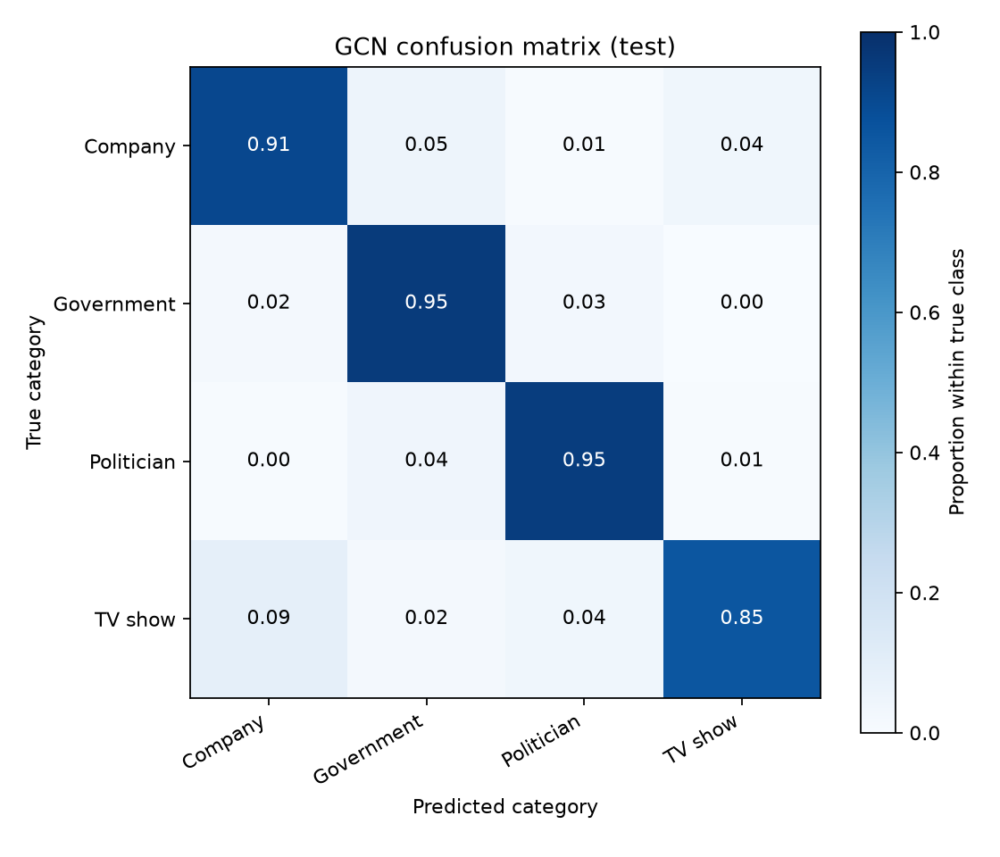

# Facebook Page Classification with an MLP Baseline and a Two-Layer GCN

**COMP3710 individual project | Levi Zheng | Student number: 48825634 | GitHub: Sharpshesho**  
**Selected task:** Multi-layer GNN, Normal difficulty. **Results recorded:** 28-29 October 2026.

This project builds a prototype assistant for a social-network analyst who needs to classify Facebook pages as Company, Government, Politician or TV show. It investigates whether graph connections improve classification compared with each page's own 128 features, and whether confidence scores help identify predictions that should be reviewed. The second question concerns the trade-off between automated coverage, remaining mistakes and review workload.

The feature-only MLP predicts from each page's input vector. The GCN combines those features with information aggregated through two graph-convolution layers, allowing neighbours up to two hops away to influence a prediction. Both produce four class scores. After training, a separate rule selected with validation data accepts predictions with sufficiently high maximum softmax scores and flags the others. The experiment simulates this decision using existing labels; actual human-review performance is not measured.

## Contents

- [Written feasibility review](#written-feasibility-review)
- [Dataset, preprocessing and split design](#dataset-preprocessing-and-split-design)
- [Models and working principles](#models-and-working-principles)
- [Experimental protocol and evaluation metrics](#experimental-protocol-and-evaluation-metrics)
- [Classification results and training behaviour](#classification-results-and-training-behaviour)
- [Computational cost](#computational-cost)
- [Implementation, dependencies and reproduction](#implementation-dependencies-and-reproduction)
- [Artificial Intelligence Usage Disclosure](#artificial-intelligence-usage-disclosure)
- [References](#references)

## Written feasibility review

*Proposal-stage review, revised 28 October 2026. The planned confidence and error analyses described here are completed in the later results sections of the final report.*

**User need, scope and acceptance criteria.** The intended user is a social-network analyst. The prototype classifies pages into four supplied categories and investigates graph context and confidence. The criteria are to: (1) compare MLP and GCN accuracy, macro-F1, AUROC and per-class precision/recall on identical held-out pages; (2) inspect confidence versus correctness, including confident mistakes; (3) select a validation cutoff and report test accepted accuracy and percentage flagged; and (4) measure training time and inference latency within the resource budget.

**Model choice and course concepts.** The Normal-difficulty task uses the modified Gayanku archive with 128 features per page [1]. An MLP provides a simple baseline. The two-layer GCN applies neighbourhood aggregation [2, 3]. Both use 64 hidden units, ReLU, dropout 0.5, cross-entropy and Adam in PyTorch. The design applies supervised loss minimisation, backpropagation, regularisation, validation-based selection and graph homophily. A stratified 60/20/20 split with seed 42 is held fixed. In this transductive setting, features and connections are available for all nodes, while only training labels enter the optimisation loss.

**Preliminary feasibility evidence.** The audit found 22,470 pages, finite features, valid edge indices and disjoint splits. Five-epoch smoke runs completed for both models. By this review revision, six full CPU runs had also completed: 200 epochs per model for training seeds 42, 43 and 44. MLP mean test accuracy was 80.04% and macro-F1 0.7808, with a 3.06-second mean training loop; GCN achieved 92.53% and 0.9200 in 22.29 seconds. These established that the planned local CPU experiments were practical. Time includes validation and checkpoint saves, excluding loading, final testing and plotting.

**Risks, budget and fallback.** The planned budget was at most 200 epochs or 30 minutes per run; measured runs met it. The code runs exactly 200 epochs and has no automatic 30-minute timeout. Risks include unequal class frequencies, misleading neighbours and overconfidence. The next planned work was to select validation cutoffs, freeze them for testing, profile inference, interpret embeddings and inspect 3-5 mistakes. The fallback was the MLP if graph benefits did not justify cost; smaller hidden layers or GPU resources were options for larger experiments.

## Dataset, preprocessing and split design

The modified Facebook Page-Page archive is linked in the course specification [1]. Nodes represent pages and connections represent mutual likes. Input shape is `(22470, 128)`. These are dense, precomputed numeric features. The publisher describes SVD-compressed description features; this project uses the supplied matrix and does not refit that transformation. Page names identify examples and are not passed into either network.

| Label | Category | All pages | Train | Validation | Test |
| --- | --- | --- | --- | --- | --- |
| 0 | Company | 6495 | 3897 | 1299 | 1299 |
| 1 | Government | 6880 | 4128 | 1376 | 1376 |
| 2 | Politician | 5768 | 3461 | 1154 | 1153 |
| 3 | TV show | 3327 | 1996 | 666 | 665 |
| Total |  | 22470 | 13482 | 4495 | 4493 |

The mapping above was checked against the original node-ID/page-type CSV for all 22,470 nodes [4]. This is the map for the actual archive; the modified repository README gives a conflicting label-order example. Archive SHA-256:

```text
7a1b8a0687515e9859d1ca649dc276825f5db44568894dfbb6b55ebc1cf6a9c1
```

`dataset.py` validates dimensions, finite features, label/name lengths, integer edge coordinates and their range, then constructs a PyG `Data` object. There are 342,004 directed edge entries, including 358 raw self-loops; this is not a count of distinct undirected friendships. Inputs become `float32`, and labels/edges become integer tensors. There is no additional feature standardisation, augmentation, resampling or class weighting. `GCNConv` supplies self-loop handling and symmetric degree normalisation [3].

Splitting is stratified independently within each class. Integer rounding per class produces 13,482 training, 4,495 validation and 4,493 test pages, approximately 60/20/20. Stratification keeps all categories in every group and preserves the smaller TV-show class. The training portion provides labelled examples, validation supports selection, and test pages support the final comparison.

This is **transductive node classification on one known graph**. All features and connections are available during message passing. The forward methods receive features and, for GCN, edges; they never receive labels. Cross-entropy uses only training labels. Validation and test labels are excluded from optimisation. Sharing covariates and edges across splits is part of this declared setting; results do not establish performance on a new, unseen graph.

## Models and working principles

MLP: `Linear(128,64) -> ReLU -> Dropout(0.5) -> Linear(64,4)`, applied separately to every page without edges. This tests the information in each page's own feature vector.

GCN: `GCNConv(128,64) -> ReLU -> Dropout(0.5) -> GCNConv(64,4)`. Each graph layer combines transformed node features with degree-normalised neighbour information, including the node itself [2, 3]. Two layers allow at most two-hop information. The comparison tests zero versus two message-passing layers, without comparing different GCN depths.

Both models have **8,516 trainable parameters**: `(128 × 64 + 64) + (64 × 4 + 4)`. Matching width, parameters, dropout and optimisation settings makes graph context the main architectural difference. Aggregation introduces extra computation despite the matching parameter counts.

Networks return raw logits. Cross-entropy compares training logits with correct labels, backpropagation calculates gradients, and Adam updates weights. Softmax is used for prediction/confidence, rather than inserted before `CrossEntropyLoss`. The predicted class is the largest score and confidence is `max(softmax(logits))`. A score of 0.95 alone does not establish a calibrated 95% probability of correctness.

## Experimental protocol and evaluation metrics

| Setting | Value |
| --- | --- |
| Split seed | 42, unchanged across all six runs |
| Training seeds | 42, 43 and 44 for each model |
| Epoch budget | 200/run; six runs, 1,200 epochs total |
| Batching | One full-graph optimisation update per epoch |
| Hidden width / dropout | 64 / 0.5 |
| Loss | Unweighted cross-entropy, training nodes only |
| Optimiser | Adam; learning rate 0.01; weight decay 0.0005 |
| Checkpoint | Highest validation macro-F1; ties use lower validation loss |
| Stopping | Exactly 200 epochs, retaining the best checkpoint; no early stopping |
| Execution | CPU; PyTorch CPU build; 20 PyTorch CPU threads during profiling |

The split seed controls page membership. Training seeds change initial weights and dropout randomness while preserving the same pages. After each epoch, training/validation curves are evaluated with dropout disabled. The best validation checkpoint is restored for testing. Five-epoch checks established pipeline operation; full-run checkpoints provide final results. Test labels do not select checkpoints or cutoffs.

Accuracy is the correct fraction of all predictions. For each class, precision is `TP/(TP+FP)` and recall is `TP/(TP+FN)`. F1 is `2 × precision × recall / (precision + recall)`, and macro-F1 averages the four class F1 values equally. This prevents the larger classes from dominating the reported score. AUROC is calculated per class against the other three using its softmax score, then averaged; it measures ranking rather than probability calibration.

Unless stated otherwise, summaries are the mean and **sample SD across three training seeds** on one fixed split. Accuracy SD is in percentage points. These are not confidence intervals or results from three independent datasets. Seed 42 is used consistently for detailed figures and cases, rather than choosing the run with the highest test score.

## Classification results and training behaviour

All metrics below use the same 4,493 test pages. Flagged pages remain included in these overall classification results.

| Model | Test accuracy, mean ± SD | Macro-F1, mean ± SD | Macro AUROC, mean ± SD |
| --- | --- | --- | --- |
| MLP | 80.04% ± 0.14 pp | 0.7808 ± 0.0025 | 0.9467 ± 0.0001 |
| GCN | 92.53% ± 0.07 pp | 0.9200 ± 0.0007 | 0.9884 ± 0.0001 |

GCN improves mean accuracy by **12.49 percentage points** and macro-F1 by **0.1392**. All three training seeds show a gain with small variation between initialisations. This supports graph context on this graph and split, without establishing significance across independent splits or generalisation to future pages.

| Model | Training seed | Best epoch | Test accuracy | Test macro-F1 | Test macro AUROC |
| --- | --- | --- | --- | --- | --- |
| MLP | 42 | 195 | 80.12% | 0.7822 | 0.9467 |
| MLP | 43 | 193 | 79.88% | 0.7779 | 0.9466 |
| MLP | 44 | 196 | 80.12% | 0.7822 | 0.9468 |
| GCN | 42 | 195 | 92.45% | 0.9192 | 0.9885 |
| GCN | 43 | 192 | 92.59% | 0.9206 | 0.9885 |
| GCN | 44 | 195 | 92.54% | 0.9201 | 0.9883 |

The next table gives per-class three-seed means; support is constant because the test split is fixed.

| Model | Class | Test support | Precision | Recall | F1 | OVR AUROC |
| --- | --- | --- | --- | --- | --- | --- |
| MLP | Company | 1299 | 0.8377 | 0.8448 | 0.8412 | 0.9555 |
| MLP | Government | 1376 | 0.7744 | 0.8639 | 0.8167 | 0.9521 |
| MLP | Politician | 1153 | 0.8005 | 0.8051 | 0.8028 | 0.9555 |
| MLP | TV show | 665 | 0.7822 | 0.5744 | 0.6624 | 0.9238 |
| GCN | Company | 1299 | 0.9312 | 0.9094 | 0.9202 | 0.9842 |
| GCN | Government | 1376 | 0.9146 | 0.9542 | 0.9340 | 0.9892 |
| GCN | Politician | 1153 | 0.9405 | 0.9506 | 0.9455 | 0.9928 |
| GCN | TV show | 665 | 0.9096 | 0.8526 | 0.8802 | 0.9874 |

TV show remains the hardest category, but mean recall improves from **57.44% to 85.26%** with GCN. Macro-F1 and class metrics expose this pattern beyond overall accuracy.



*Figure 1. MLP, seed 42. Vertical dashed line: validation-selected epoch 195.*



*Figure 2. GCN, seed 42. Vertical dashed line: validation-selected epoch 195.*

Both improve rapidly, then flatten. MLP develops a clearer training/validation loss gap; GCN curves remain closer for this run. That is consistent with useful graph structure, but close curves alone cannot prove absence of overfitting or leakage. Selection uses the recorded validation criterion.



*Figure 3. MLP, seed 42. Rows: true classes; columns: predictions.*



*Figure 4. GCN, seed 42. Diagonal entries are class recall, rather than precision.*

For GCN seed 42, correct counts are 1,180/1,299 Company, 1,313/1,376 Government, 1,093/1,153 Politician and 568/665 TV-show pages. The largest error counts are Company to Government (62), TV show to Company (59), and Company to TV show and Politician to Government (48 each). The figure rounds proportions; saved files retain exact counts.

## Computational cost

| Model | Parameters | Training/run, mean ± SD | Full-graph inference, mean ± SD | Peak GPU VRAM |
| --- | --- | --- | --- | --- |
| MLP | 8,516 | 3.06 ± 0.09 s | 0.427 ± 0.041 ms | N/A: CPU |
| GCN | 8,516 | 22.29 ± 0.28 s | 23.733 ± 0.589 ms | N/A: CPU |

Training time includes 200 epochs of optimisation, per-epoch training/validation evaluation and checkpoint saves. Loading, final testing and plotting are excluded. Each inference profile uses 5 untimed warmups and 30 timed evaluation-mode forwards. The table averages the three run-level means and gives their sample SD. It uses original `outputs/evaluation` profiles, without pooling additional timings created during t-SNE generation.

One timed forward processes **all 22,470 nodes**, although classification metrics select only test pages. Timing excludes loading, transfers, metrics, cutoff search and plots; it is not isolated-page response latency. Profiles record Windows x86-64, processor descriptor `Intel64 Family 6 Model 198 Stepping 2, GenuineIntel`, 20 PyTorch CPU threads and `torch 2.14.1+cpu`. GPU VRAM is not applicable for CPU execution. Peak host memory was not measured.

GCN training is about **7.28 times** slower and its full-graph forward about **55.59 times** slower. Aggregation over 342,004 directed entries and on-the-fly graph normalisation adds work despite equal parameter counts. Both remain practical for local experiments, with GCN full-graph inference averaging about 24 ms. These microbenchmarks exclude service overhead and do not establish deployment throughput.

## Implementation, dependencies and reproduction

`modules.py` defines both model classes. `dataset.py` loads and validates data and creates split masks. `train.py` trains, selects checkpoints and saves histories/curves. `predict.py` loads checkpoints and saves metrics, confidence decisions, timings, plots and examples. Trainable networks use PyTorch/PyG; NumPy supports archive loading and reporting.

The tested Windows x86-64 environment used Python **3.13.17**, PyTorch **2.14.1+cpu**, torch-geometric **2.8.1**, NumPy **2.5.4**, scikit-learn **1.9.1** and Matplotlib **3.11.2**. `requirements.txt` pins corresponding package versions; the local CPU build carries `+cpu`. No CUDA device was used. Different hardware/package versions can change timing and small floating-point results.

Run these PowerShell commands in `recognition/MultiLayerGNN_Sharpshesho`. The interpreter path explicitly selects the project's environment. Data and weights remain local.

```powershell
py -3.13 -m venv .venv
.\.venv\Scripts\python.exe -m pip install -r requirements.txt
```

Download the course-linked archive if a verified local copy is not already present:

```powershell
Invoke-WebRequest -Uri "https://raw.githubusercontent.com/gayanku/facebook_page-page_dataset/main/facebook.npz" -OutFile "facebook (1).npz"
Get-FileHash -LiteralPath "facebook (1).npz" -Algorithm SHA256
```

The archive is an example input: `X` gives 128 features/page, `edges_x`/`edges_y` graph coordinates, `y` labels and `page_name` display metadata. Check its SHA-256 against the dataset section. Use a fresh `outputs/reproduced` directory for the commands below; these paths keep reproduced outputs separate from the recorded experiment.

Train both models for all seeds:

```powershell
foreach ($model in @("mlp", "gcn")) {
    foreach ($seed in @(42, 43, 44)) {
        & .\.venv\Scripts\python.exe train.py --data-path "facebook (1).npz" --model $model --epochs 200 --hidden-channels 64 --dropout 0.5 --learning-rate 0.01 --weight-decay 0.0005 --seed $seed --split-seed 42 --device cpu --log-every 10 --output-dir outputs\reproduced\full
        if ($LASTEXITCODE -ne 0) { throw "Training failed: $model, seed $seed" }
    }
}
```

Evaluate six saved models with the validation-selection rule:

```powershell
foreach ($model in @("mlp", "gcn")) {
    foreach ($seed in @(42, 43, 44)) {
        $checkpoint = "outputs\reproduced\full\${model}_seed${seed}_best.pt"
        & .\.venv\Scripts\python.exe predict.py --data-path "facebook (1).npz" --checkpoint $checkpoint --split test --device cpu --min-validation-coverage 0.5 --timing-warmup 5 --timing-runs 30 --skip-embedding-plot --output-dir outputs\reproduced\evaluation
        if ($LASTEXITCODE -ne 0) { throw "Evaluation failed: $model, seed $seed" }
    }
}
```

Create representative t-SNE plots using the existing seed-42 weights:

```powershell
foreach ($model in @("mlp", "gcn")) {
    $checkpoint = "outputs\reproduced\full\${model}_seed42_best.pt"
    & .\.venv\Scripts\python.exe predict.py --data-path "facebook (1).npz" --checkpoint $checkpoint --split test --device cpu --min-validation-coverage 0.5 --embedding-max-nodes 2000 --output-dir outputs\reproduced\visualisations
    if ($LASTEXITCODE -ne 0) { throw "Plot generation failed: $model" }
}
```

Prediction saves class metrics, per-page decisions and figures without optimisation. Training recreates the checkpoints, so downloading weights is unnecessary. Fixed seeds support repeatability within the tested environment without guaranteeing bitwise identical results on every platform. Re-running these commands is optional when inspecting the already saved results.

## Artificial Intelligence Usage Disclosure

OpenAI Codex assisted with explanations of graph learning and evaluation concepts, Python implementation and debugging, data-audit and reporting code, result checks, and drafting this README and feasibility review. AI assistance included substantive code and document development.

Verification used the local data audit, five-epoch MLP/GCN smoke runs, six complete 200-epoch CPU runs and inference from saved checkpoints. Checks confirmed fixed split metadata and matching test-node IDs, agreement between saved training/test results and prediction metrics, consistent prediction counts and confidence decisions, and identical sampled IDs for the embedding figures. Error analysis examines actual predictions and graph neighbours. Proposed failure causes are identified as hypotheses where no ablation was performed. I am responsible for reviewing and understanding the submitted code, calculations and claims.

## References

1. Gayanku, [Facebook Page-Page dataset repository](https://github.com/gayanku/facebook_page-page_dataset), modified 128-feature archive; identity and class order verified for this experiment.
2. T. N. Kipf and M. Welling, [Semi-Supervised Classification with Graph Convolutional Networks](https://arxiv.org/abs/1609.02907), ICLR 2017.
3. PyTorch Geometric, [`GCNConv` documentation](https://pytorch-geometric.readthedocs.io/en/2.8.1/generated/torch_geometric.nn.conv.GCNConv.html). The implementation uses this library operator rather than reimplementing its message-passing primitive.
4. Original node labels, [`musae_facebook_target.csv`](https://github.com/gayanku/facebook_page-page_dataset/blob/main/facebook_large/musae_facebook_target.csv), used to check numeric-label names by node ID.
5. COMP3710/COMP7710 teaching team, *Pattern Recognition Report: Version 2.5 Final Assessment Specification*, course handout, classification guidelines and Sections 3-6.
